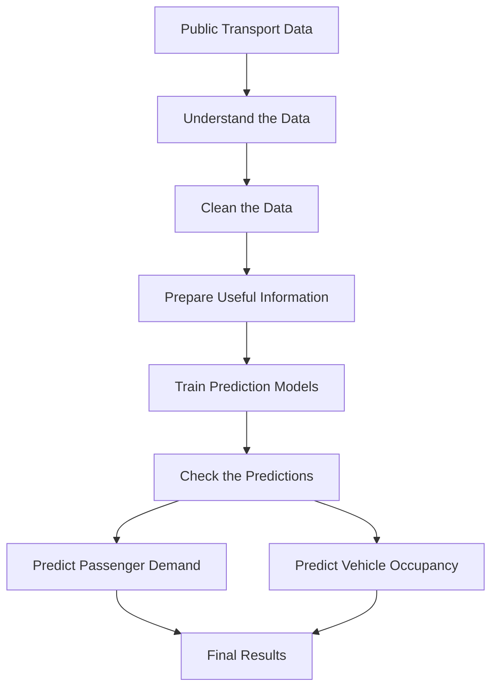

# Architecture

Our project is about predicting how many people may travel by public transport and how crowded a bus or other vehicle might be.

Let's understand it with a simple example.

Suppose a bus travels on the same route every day. On Monday, 50 people travel by that bus. On Tuesday, 70 people travel, and on Wednesday, 90 people travel.

If we look at the information from previous days, we may find a pattern. Using that pattern, we can try to guess how many people might travel on the next day.

This is what our project aims to do with the help of data and Machine Learning.

To make this work, we have divided the project into different steps. Each step has a different job.

## Overall Workflow

The following diagram shows how our project will work.



Let's understand each step.

- First, we collect information about previous passenger journeys.
- Then, we check the data and remove or handle incorrect information.
- After that, we prepare the information that will help our model make predictions.
- Next, we teach the model using previous travel records.
- Finally, we check how well the model works and study its predictions.

In simple words, we are teaching a computer to learn from old travel information so that it can make an estimate about future travel.

## Stages

Our project will be completed in the following stages.

| Stage | What will happen? | What will we get? |
|---|---|---|
| Data Inspection | We will look at the dataset and understand what information it contains. | Understanding of the dataset |
| Data Cleaning | We will find missing, repeated or incorrect information. | Clean data |
| Data Processing | We will arrange the information in a proper format. | Organized data |
| Feature Creation | We will select useful information that can help in prediction. | Information for the model |
| Baseline Model | We will first try a simple prediction method. | First prediction results |
| Model Training | We will train different models using past travel information. | Trained models |
| Model Evaluation | We will check how close the predictions are to the actual values. | Model performance |
| Occupancy Estimation | We will estimate how much of a vehicle's capacity may be occupied. | Occupancy predictions |
| Result Analysis | We will study the results and compare different models. | Final observations |

We may make changes to these steps as we learn more about the data and work on the project.

## Key Design Choices

While planning this project, we need to keep a few things in mind.

### 1. Understanding the Data First

Before making predictions, we need to understand what information is available to us.

For example, we need to check whether the dataset contains passenger counts, route details and travel times.

This will help us decide what kind of predictions we can make.

### 2. Demand and Occupancy Are Different

Both are related to passengers, but they tell us different things.

- **Demand:** How many people are expected to travel?
- **Occupancy:** How much of the vehicle's capacity is expected to be occupied?

For example, if 40 people are expected to travel, that is the passenger demand. If the vehicle has space for 50 people, its estimated occupancy is 80%.

We will study both of these separately.

### 3. Starting with a Simple Model

We will not start with a complicated model immediately.

First, we will try a simple method called a baseline model.

Think of it as our starting point. Later, we will try other models and check whether they give better predictions.

### 4. Not Using Future Information

One important thing is that the model should not know the answer before making a prediction.

For example, if we want to predict tomorrow's passengers, we can use information from previous days, but we cannot use tomorrow's actual passenger count.

Otherwise, the prediction would not be a fair one.

This problem is called data leakage.

### 5. Checking Model Performance

After making predictions, we need to check whether they are close to the actual values.

For example, if the actual number of passengers is 100 but our model predicts 90, the difference is 10 passengers.

We will use different methods to measure these differences and compare the models.

### 6. Saving Our Work

We will save important information about our experiments, such as:

- Which dataset was used.
- Which model was tested.
- What settings were used.
- What results were obtained.
- What changes were made.

This will help us repeat our work and understand how we got our results.

## Code Map

Our project is still in its starting stage, so the number of files is small.

The current folder structure looks like this:

```text
transit-demand-occupancy-main/
│
├── README.md
│
├── docs/
│   ├── project-plan.md
│   └── docs/
│       ├── experiment-log.md
│       └── document pending technical decisions
│
├── scripts/
│   └── profile_dataset.py
│
└── .gitignore
```

### What Does Each File Do?

| File | Simple Explanation |
|---|---|
| `README.md` | Gives a short introduction to our project. |
| `project-plan.md` | Tells us what work needs to be done. |
| `experiment-log.md` | Helps us save the experiments we perform and their results. |
| `document pending technical decisions` | Used to write down technical decisions that are still not finalized. |
| `profile_dataset.py` | Helps us look at the dataset and understand the information inside it. |

As we continue working, we will add more files for cleaning data, preparing features, training models and checking predictions.

## Expected Data Flow

Let's understand how information will move through our project.

1. We will first collect the public transport data.
2. We will look at the data and understand what it contains.
3. We will clean and organize the information.
4. We will prepare useful details that can help in making predictions.
5. We will train different prediction models.
6. We will check how well these models work.
7. We will save the results and compare them.

Each step will prepare something that we need for the next step.

## Reproduction Record

Suppose another person wants to run our project on their computer.

They should be able to follow our instructions and understand how we got our results.

For this reason, we plan to save:

- Where the dataset came from.
- Which version of Python and other libraries was used.
- How the data was cleaned.
- Which information was given to the models.
- Which model settings were used.
- How the experiments were performed.
- What results were obtained.

We will keep these details updated as the project develops.

## Conclusion

This project uses past public transport data to understand passenger travel patterns and predict future demand and occupancy.

The process starts with collecting and preparing the data. After that, different prediction models are used to estimate passenger demand and vehicle occupancy. Their results are then compared to understand which approach works better.

The main aim is to make better use of available transport data and understand how passenger demand changes across different routes and times.